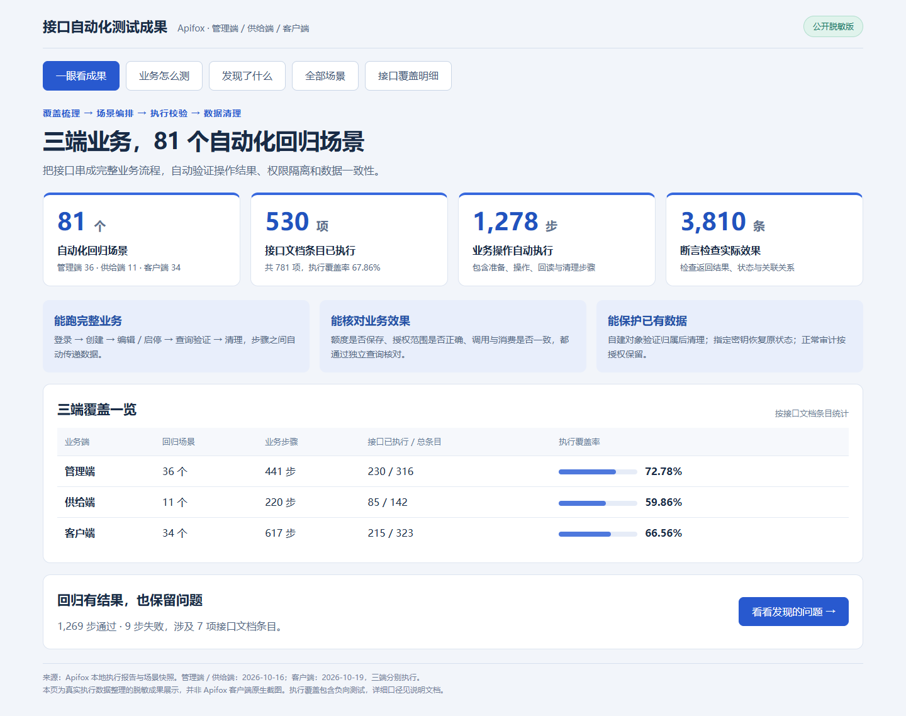

# QA 测试作品集

这里整理了我的接口自动化、UI 自动化、性能测试、功能测试实践，以及个人独立开发的 AI 模型渠道测试工具。

## 从这里开始

| 项目 | 可以看到什么 | 推荐入口 |
|---|---|---|
| Token 运营平台测试 | 三端接口回归、UI 自动化、性能压测、功能用例与边界数据 | [项目说明](./Token运营平台-已脱敏-更新中~/) · [接口自动化成果](./Token运营平台-已脱敏-更新中~/接口自动化/) |
| AI 模型渠道测试平台 | 个人独立开发工具的 Windows / Mac 分发包与脱敏用户手册 | [下载与使用说明](./AI模型渠道测试平台（个人独立开发）/) |
| 企业内部综合管理系统 | 功能用例、接口集合、数据库验证与测试报告 | [项目说明](./企业内部综合管理系统-练手/00-项目说明/README.md) · [分类索引](./企业内部综合管理系统-练手/分类索引.md) |

## 接口自动化成果

使用 Apifox 编排管理端、供给端、客户端 **81 个回归场景、1,278 个业务步骤、3,810 条断言**。实际执行 **530 / 781 项接口文档条目，覆盖率 67.86%**。



[查看业务闭环和发现的问题](./Token运营平台-已脱敏-更新中~/接口自动化/)。图中结果来自三端分别执行的历史完整回归，保留 9 个失败步骤；图表为真实数据整理的脱敏展示，非 Apifox 客户端原生截图。

## 获取资料

文档、图片、用例和代码可直接浏览。两个应用分发包通过 Git LFS 存储，可在对应文件页面下载。

如果需要克隆完整仓库并取得安装包，请先安装 Git LFS，再执行：

```bash
git lfs install
git clone https://github.com/Reyon-1/qa-testing-portfolio.git
```

公开测试资料中的示例账号、示例地址和边界值用于解释测试设计。运行脚本前应配置自己的测试环境与凭据，勿直接对生产环境执行。
