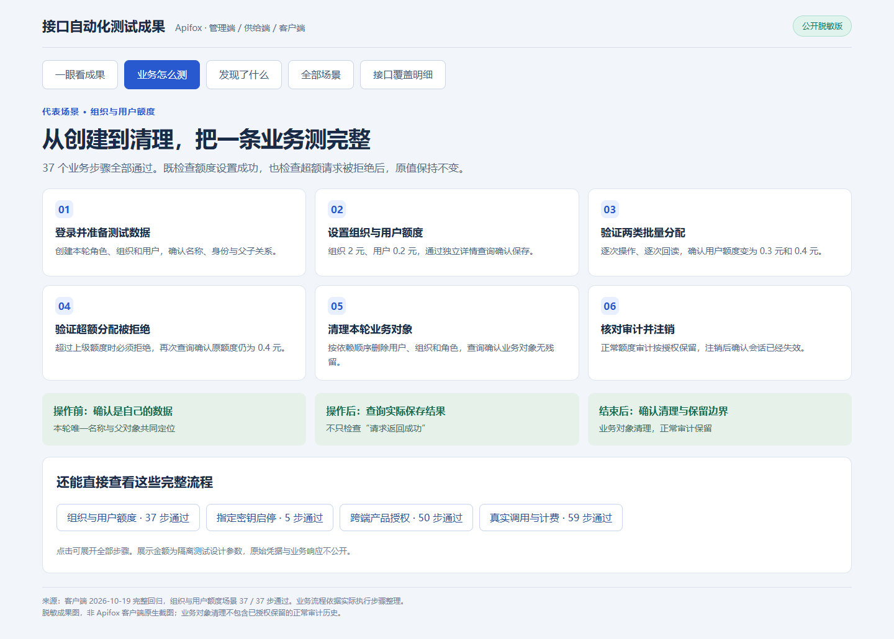
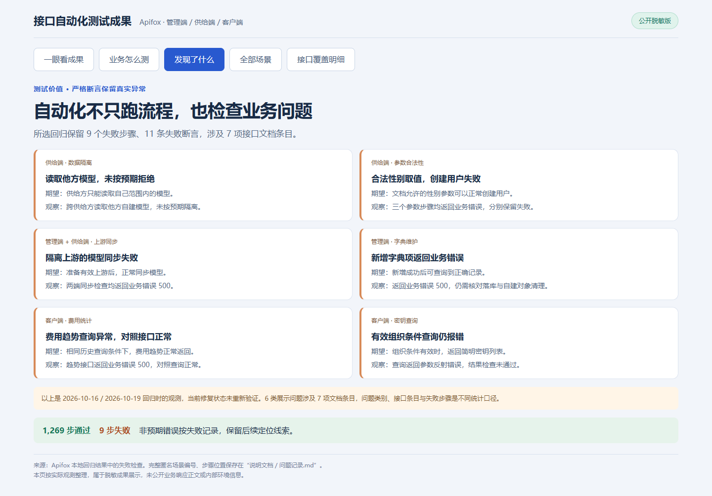

# 三端接口自动化测试成果

使用 **Apifox** 搭建管理端、供给端、客户端的接口自动化回归。把登录、资源创建、业务操作、结果校验和数据清理串成可重复执行的测试流程。

## 做出了什么

| 测试成果 | 实际规模 |
|---|---|
| 覆盖三个业务端 | 管理端、供给端、客户端 |
| 编排回归场景 | **81 个**，包含登录鉴权、增删改查、启停、权限与额度等流程 |
| 执行业务步骤 | **1,278 步**，设置 **3,810 条断言** |
| 接口执行覆盖 | **530 / 781 项文档条目，覆盖率 67.86%** |
| 记录回归结果 | **1,269 步通过、9 步失败**，失败检查完整保留 |

## 业务流程怎么测

以“组织与用户额度”为例，完整流程共 **37 步，37 步通过**。既检查设置是否真正生效，也检查超额操作被拒绝后，原来的额度是否保持不变。

| 其他代表场景 | 测试流程与校验重点 |
|---|---|
| 接口密钥启停 | 读取原状态 → 禁用 → 查询确认 → 启用 → 确认恢复原状态 |
| 跨端产品授权 | 管理端准备产品 → 客户端按组织、用户、全部范围授权 → 逐次查询核验 → 清理依赖资源 |
| 真实模型调用与计费 | 自建账号、密钥与产品 → 三种文本协议各调用一次 → 核对调用与消费记录 → 清理自建对象 |
| 文件处理 | 上传 → 下载 / 预览 → 核对文件内容或结构 → 删除 |

查看[代表场景讲解](./说明文档/代表场景.md)，可以直接了解每条流程的目的和验证方式。

## 自动化实际发现了什么

这些检查来自所选历史回归，共 **9 个失败步骤、11 条失败断言**，涉及 **7 项文档条目**。包括跨供给方模型读取隔离不符合预期、合法参数创建用户失败、费用趋势查询异常等。详情见[问题记录](./说明文档/问题记录.md)，当前修复状态未在本次整理中重新验证。

## 三端分别做到多少

| 业务端 | 回归场景 | 业务步骤 | 接口文档条目已执行 | 执行覆盖率 |
|---|---:|---:|---:|---:|
| 管理端 | 36 | 441 | 230 / 316 | 72.78% |
| 供给端 | 11 | 220 | 85 / 142 | 59.86% |
| 客户端 | 34 | 617 | 215 / 323 | 66.56% |

我负责三端接口覆盖梳理、Apifox 场景编排、变量传递、业务断言、跨端对账和执行后清理。操作自建资源前先确认归属，操作既有资源后核对并恢复状态，正常调用、消费和额度变更审计按授权保留。

## 继续查看

- **直接看成果**：本页三张图已经展示核心成果，在 GitHub 上即可阅读。
- **演示业务流程**：下载目录后，双击[成果展示.html](./成果展示.html)，打开中文展示页，点击代表场景查看完整步骤。
- **了解测试设计**：[代表场景讲解](./说明文档/代表场景.md) · [场景设计](./说明文档/场景设计.md) · [81 个场景清单](./说明文档/场景清单.md)。

查看详细执行证据与统计口径

| 材料 | 内容 |
|---|---|
| [执行汇总](./执行证据/执行汇总.json) | 三端场景、步骤、断言和覆盖统计 |
| [接口覆盖明细](./执行证据/接口覆盖明细.csv) | 781 项文档条目的执行状态 |
| [场景执行明细](./执行证据/场景执行明细.csv) | 81 个场景的通过与失败步数 |
| [完整场景步骤](./执行证据/场景步骤.json) | 每个场景的步骤顺序和断言结果 |
| [匿名断言记录](./执行证据/断言执行记录.xml) | 保留断言数量与失败位置的 JUnit 记录 |
| [统计口径与脱敏说明](./说明文档/统计口径与脱敏说明.md) | 数据来源、执行边界和脱敏方式 |

结果取自管理端 / 供给端 2026-10-16、客户端 2026-10-19 的完整回归，三端分别执行。覆盖按文档条目统计，包含预期拒绝的负向测试，不能等同于全部正常业务成功。523 项文档条目断言通过，其中管理端 1 项仅负向覆盖。

三张展示图根据真实执行数据整理，属于脱敏成果图，并非 Apifox 客户端原生截图。公开材料不含真实账号、密码、令牌、密钥、内网地址和原始业务响应。场景结构用于说明测试工作，不含内部环境所需的认证配置。

离线核验：在本目录运行 `python 核验工具/核验成果.py`，检查统计一致性与公开文本脱敏情况。

